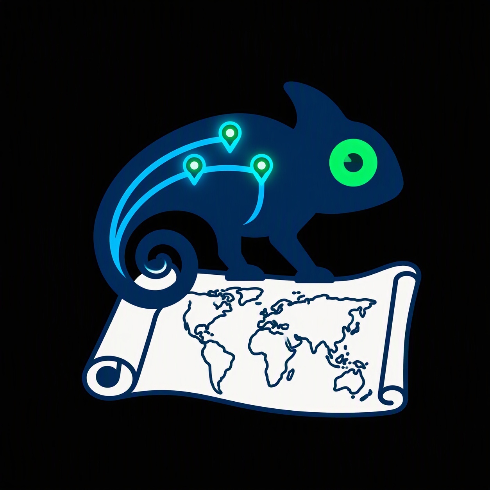

# ⏳ Mapa mundi interactiu 

En la següent web trobareu un mapa mundi on, en clicar en 15 zones diferents, canvia el color del territori. Hi ha 6 colors disponibles (groc, roig o vermell, verd, lila, blau i negre). Cada color pot representar un equip o una persona que, quan conquereix una zona, la pinta del seu color. El negre pot funcionar com a avís de zona que està en canvi de propietari (per exemple, si l'està conquerint un altre equip).

Aquesta és una forma de donar sentit als colors, mes cadascú hi pot donar el valor que li sigui més convenient.

 

---

# Origen

El mapa interactiu que teniu a disposició va néixer com a taulell de joc per a una activitat d'Esplai (similar als Caus o Scouts) on hi havia proves, recursos i molt més, seguint la idea dels jocs de conquesta.

Ara està disponible per a l'ús públic i no comercial, per si necessiteu un mapa interactiu tipus taulell. 

🔗 **Accés al web:** [**Mapa mundi interactiu (index.html)**] ([index.html](https://github.com/enginyera-filologica/mapa-mundi-interactiu/deployments/github-pages))

---

## 🔒 Llicència

Aquest mapa i les seues dades estan sota la llicència **Creative Commons Reconeixement-NoComercial 4.0 Internacional (CC BY-NC 4.0)**.

Pots compartir i modificar aquest mapa lliurement sempre que en citis l'autoria original i no l'utilitzis per a finalitats comercials. Vegeu el fitxer [LICENSE](LICENSE) per a més detalls.
